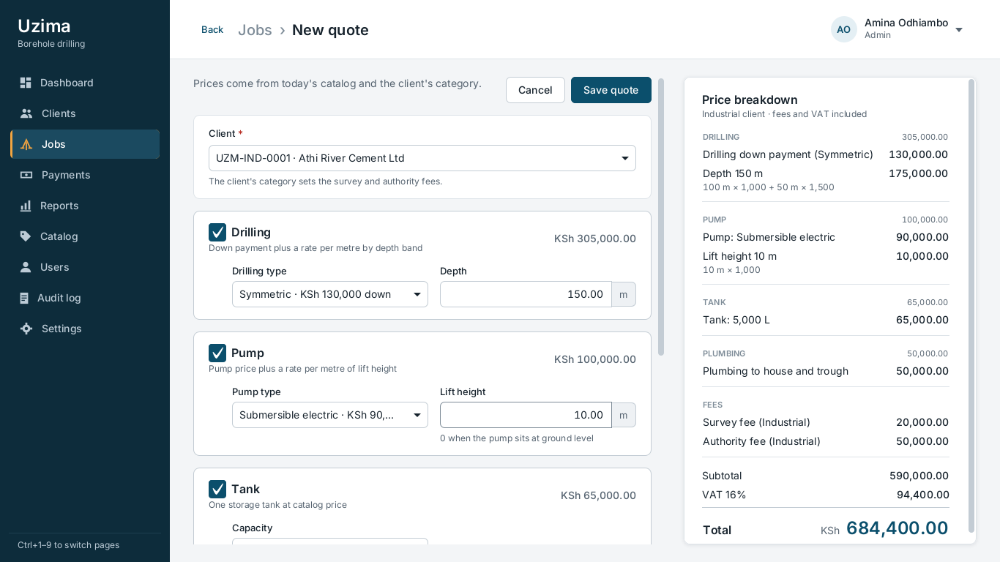
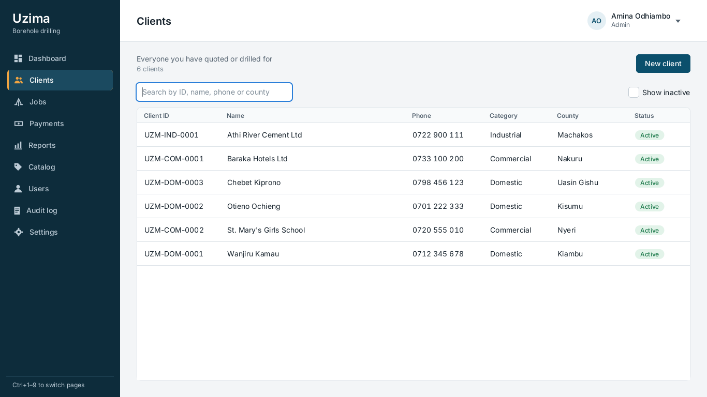
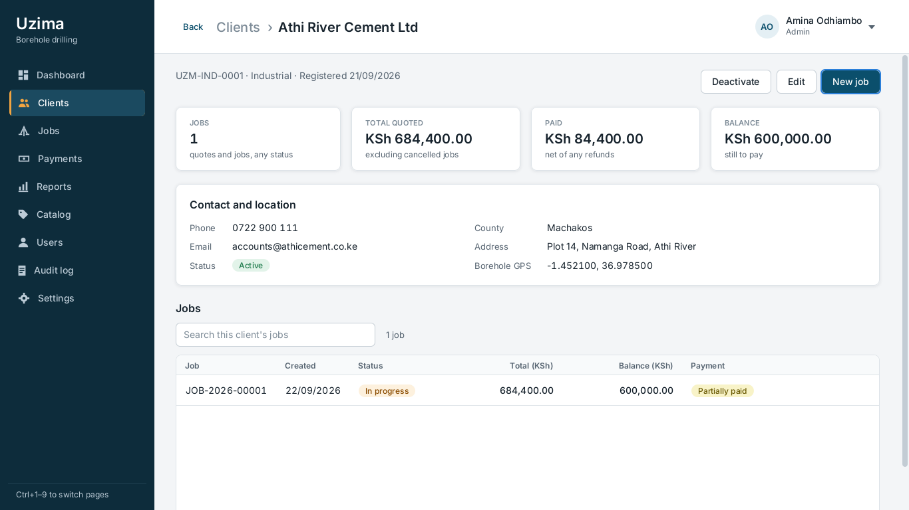
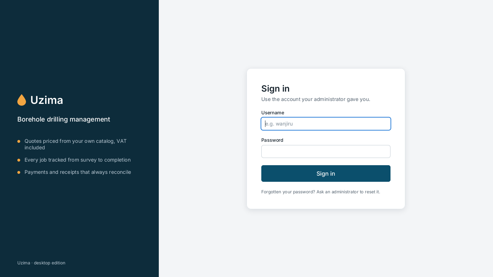
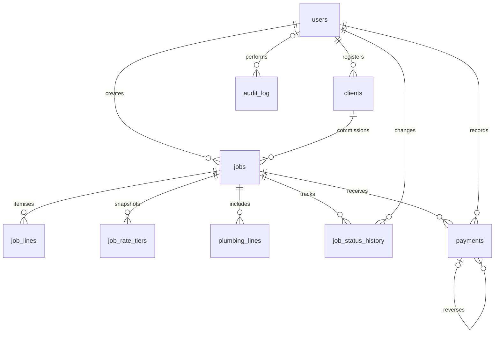

# Uzima - borehole drilling management for Kenya

[![Main CI][main-badge]][main-ci]
![Java 21][java-badge]
![JavaFX 21][javafx-badge]
![H2 / MySQL 8][database-badge]

A desktop application for Uzima Borehole Drilling Company, bringing client records, quotes,
job progress and payment records into one workflow. Quotes cover drilling depth, pumps, tanks
and plumbing, with itemised costs and VAT in Kenyan shillings.

Built with Java 21 and JavaFX 21. An embedded H2 database keeps local setup simple.
MySQL 8 is supported for installations that need a database server. Pricing, permissions and
persistence are tested independently of the interface.

**Status:** active rebuild, currently Phase 3. Client and quote screens run against real services
in the UI tests, but the normal launcher does not yet register them in its sidebar. It opens
first-run setup, sign-in and the shell. See [Limitations and roadmap](#limitations-and-roadmap).



**Try the current launcher:** with JDK 21 installed, run `./mvnw javafx:run`
(`.\mvnw.cmd javafx:run` on Windows). No separate Maven install or database server is needed.
First run creates the local database and asks you to create an administrator.

## Contents

- [Background](#background)
- [Features](#features)
- [Screenshots](#screenshots)
- [Database design](#database-design)
- [Getting started](#getting-started)
- [Testing and quality](#testing-and-quality)
- [Project structure](#project-structure)
- [Limitations and roadmap](#limitations-and-roadmap)

## Background

Uzima is a rebuild of an earlier desktop application. The legacy histories are preserved in Git,
while the current code separates business rules, pricing, services, SQL and JavaFX screens.

The focus is on reliable everyday records: a quote should not change when catalog prices change,
a refund should leave a trace, and two staff members recording payments must not overpay the same
job. The reasoning behind these choices lives in the [design decision log](docs/decisions.md).

## Features

### Client and quote screens

These screens are implemented and covered by TestFX. Application-wide wiring is still in progress.

- **Client register:** search and sort clients; record category, Kenyan phone number, county,
  address and optional borehole GPS coordinates.
- **Client detail:** view jobs, invoiced amounts, payments, balances and refunds due. Category
  corrections keep the original client code and leave existing quotes unchanged.
- **Quote editor:** combine drilling, pump installation, tanks and manual or itemised plumbing.
  See the price breakdown update as inputs change, including depth bands, fees and VAT.
- **Explicit re-pricing:** editing a pending quote keeps saved prices. A separate comparison shows
  the effect of applying current catalog prices before committing the change.
- **Keyboard support:** keyboard-only client and quote entry, searchable tables, inline validation,
  modal focus handling and a shell-owned initial-focus rule.

### Business rules and services

These rules are implemented below the UI, even where their dedicated screens are still pending.

- **Exact amounts:** `BigDecimal`-backed money and metres, with explicit rounding and stable
  `KSh 1,234,567.00` formatting.
- **Job lifecycle:** pending survey, approved, in progress, completed and cancelled states;
  validated transitions and recorded status history.
- **Payment records:** cash, M-Pesa, bank transfer and cheque, with method-specific references,
  receipt numbers and partial reversals. This records payments; it does not process transfers.
- **Cancellation accounting:** cancelled jobs owe nothing; any money still held becomes a refund
  due. Reversals remain possible, while new payments are blocked.
- **Staff access:** Admin, Manager and Clerk permissions enforced in services, with password
  hashing, login lockout and an audit trail for changes.
- **Transactional writes:** jobs, quote lines, document numbers and audit entries commit together.
  Concurrent payment recording locks the job before validating the remaining balance.

## Screenshots

Real JavaFX scenes rendered by the headless UI tests, not design mockups. The client and quote
screens below are opened by the test harness while launcher wiring is being completed. Preview
sidebar entries in these images do not imply that all nine destinations are implemented.

The fixtures use one sample story: six clients, six jobs and four payments, with the clock fixed
to 16 October 2026 in Nairobi. No screenshot data is loaded into a normal installation.

### Client register



### Client detail



### Sign-in



The quote editor appears at the top of this README. The tests also generate first-run, validation,
empty-state and dialog views at 1280x720 and 1366x768 in `target/ui-snapshots/`.

## Database design

### Core relationships

This is an overview of the business tables, not the complete schema:



### Migrations

Flyway runs the same SQL migrations on embedded H2 in MySQL compatibility mode and on MySQL 8.

- [V1: schema][schema] creates clients, users, catalogs, jobs, quote lines, payments,
  status history, audit records, settings and document-number sequences, plus `job_accounts`.
- [V2: reference data][reference-data] seeds drilling, pump, tank and pipe catalogs, rate tiers,
  category fees and initial settings. It does not create staff accounts or demo clients.

### Saved prices and derived balances

A job stores its input specification, price basis and priced lines. Catalog names, unit prices,
category fees, rate tiers and VAT are deliberate historical snapshots: a later catalog change must
not silently change a quote already given to a client.

Paid amounts, balances, payment status and refunds due are derived by the `job_accounts` view
from the payment ledger. They are not separately maintained totals that can drift out of sync.

### Constraints and transactions

- Foreign keys connect clients, jobs, staff and payments; unique constraints protect client codes,
  usernames, job numbers and receipt numbers.
- A database `CHECK` requires positive received payments and negative reversal entries.
  Repositories expose no payment update or delete operation.
- Money uses `DECIMAL(14,2)`, metres use `DECIMAL(8,2)`, and timestamps are stored in UTC.
  Calendar rules use `Africa/Nairobi`.
- JDBC transactions group each business change with its audit entry. Job and sequence row locks
  protect concurrent payment recording and document numbering.
- Integration tests exercise repositories, rollback and concurrency on both H2 and real MySQL.

## Getting started

### Requirements

- JDK 21, including the Java compiler, on your `PATH`.
- A graphical desktop for launching JavaFX. The automated UI tests run headlessly.
- Git and network access for the first Maven dependency download.
- Optional: Docker for MySQL integration tests, or a MySQL 8 server for an installation.

### Run from source

Clone the current application from `main`:

```bash
git clone --branch main https://github.com/f4zzie/uzima.git
cd uzima
./mvnw javafx:run
```

On Windows, use `.\mvnw.cmd` wherever these examples use `./mvnw`.
The committed Maven wrapper downloads the required Maven version.

On first start, Uzima creates and migrates the embedded database, then asks for the first
administrator's details. There is no shared administrator password or production demo account.

### Data and configuration

The default application data directory follows the operating system:

- **Linux:** `$XDG_DATA_HOME/uzima`, or `~/.local/share/uzima` when `XDG_DATA_HOME` is unset.
- **Windows:** `%APPDATA%\Uzima`.
- **macOS:** `~/Library/Application Support/Uzima`.

Set `UZIMA_HOME` to use a different directory, for example an isolated test installation.
Logs are written to `<app data>/logs/uzima.log` and roll daily.

Configuration is loaded in this order; later sources override earlier ones:

1. [Bundled application defaults][application-properties].
2. `<app data>/uzima.properties`, an optional installation-specific file.
3. Environment variables `UZIMA_DB_URL`, `UZIMA_DB_USER` and `UZIMA_DB_PASSWORD`.

For MySQL, create an empty database and configure its JDBC URL and credentials using those
environment variables or the [example properties file](uzima.properties.example). Flyway applies
the schema on startup. Keep passwords out of Git and prefer the environment variable.

The default H2 database is a local file with no database password; protect its directory with
operating-system permissions. It is not an encrypted data store.

## Testing and quality

```bash
./mvnw verify          # Compile, test, check formatting and enforce coverage
./mvnw spotless:apply  # Format Java with google-java-format
```

- **Domain and pricing tests** cover validation, tier boundaries, rounding, saved prices,
  payment reversals, VAT and job transitions.
- **Service and persistence tests** cover permissions, audit records, transactional rollback and
  concurrent writes. MySQL cases use Testcontainers and skip when Docker is unavailable.
- **TestFX flows** exercise real JavaFX controls with services and an isolated H2 database.
  Snapshots cover normal screens, validation errors, dialogs and empty states.
- **Architecture checks** keep JavaFX and persistence dependencies out of domain and pricing code
  and reject floating-point arithmetic there.
- **Design checks** enforce theme tokens, status-badge contrast and tabular digit widths.
- **Coverage:** `verify` enforces at least 80% line coverage across domain, pricing and services.
  The full report is written to `target/site/jacoco/index.html`.
- **CI:** GitHub Actions runs `verify` on Ubuntu and Windows, with test reports and UI snapshots
  uploaded even when a job fails.

### Navigation regression gate

Every new sidebar page must declare its initial control through `InitialFocus` and pass all
**18 sidebar focus cases** in `NavigationFocusTest`: nine destinations, each by mouse and keyboard
shortcut. The shell calls `requestInitialFocus()` once when navigation and layout are ready.
The current suite uses the real Clients page and preview destinations for the remaining routes;
those previews must be replaced as real pages are wired.

Run the focus checks and the two keyboard flows:

```bash
./mvnw -Dtest=NavigationFocusTest,NavigationLifecycleTest test
./mvnw -Dtest=QuoteEditorFlowTest,ClientsFlowTest test
```

### Headless diagnostics

Surefire explicitly sets the TestFX and Monocle flags in `pom.xml`:

```text
-Dtestfx.robot=glass
-Dtestfx.headless=true
-Dglass.platform=Monocle
-Dmonocle.platform=Headless
-Dprism.order=sw
```

For focus failures, enable the test-only timeline:

```bash
./mvnw -Dtest=QuoteEditorFlowTest,ClientsFlowTest -Duzima.focusTimeline=true test
```

Failure messages report stage focus, the scene's focus owner and the expected node.
With tracing enabled, they also include focus changes, short stack traces and navigation markers.
Failure PNGs are written to `target/ui-snapshots/failures/`; Surefire reports are under
`target/surefire-reports/`.

On Linux, the stress runner executes both flow classes 30 times with POM defaults and another
30 times with explicit CI flags, retaining every result rather than retrying failures:

```bash
python3 tools/stress-keyboard-flows.py --runs 30 --mode both --focus-timeline
```

Logs, XML reports and a JSON summary are retained under `target/keyboard-stress/`.
The [keyboard stress workflow][stress-ci] splits this into independent Ubuntu jobs.

## Project structure

- `src/main/java/com/uzima/domain/`: immutable business types and validation.
- `src/main/java/com/uzima/pricing/`: quote calculation, tiers and re-pricing.
- `src/main/java/com/uzima/service/`: use cases, permissions and transaction boundaries.
- `src/main/java/com/uzima/persistence/`: JDBC repositories, pooling and database startup.
- `src/main/java/com/uzima/ui/`: JavaFX screens, view models, components and navigation.
- `src/main/java/com/uzima/app/`: launcher, configuration and service composition.
- `src/main/resources/db/migration/`: versioned schema and reference data.
- `src/main/resources/com/uzima/ui/`: FXML, theme and bundled Inter fonts.
- `src/test/`: unit, integration, UI and snapshot tests, including shared sample data.
- `tools/`: keyboard stress runner and tabular-font generation.
- `docs/`: design decisions and selected UI screenshots.
- `.github/workflows/`: cross-platform verification and keyboard stress checks.

## Limitations and roadmap

- **Phase 3 is not complete.** The launcher still supplies an empty destination list. `AppPages`
  wiring, top-bar quick search and the jobs and payments screens are the next integration work.
- Change-password and lock-screen components still need complete application routing and flow
  coverage. The current sign-in route does not enforce the forced password-change screen yet.
- The remaining sidebar destinations, including reports, catalog administration, user management
  and settings, are not complete application screens. Invoices and report exports are planned.
- Payment methods describe externally received money. There is no M-Pesa API or bank integration.
- Dark mode and native installers are not delivered yet; development builds run from source.
- macOS data paths are supported, but the CI matrix currently verifies only Ubuntu and Windows.

[main-badge]: https://github.com/f4zzie/uzima/actions/workflows/ci.yml/badge.svg?branch=main
[main-ci]: https://github.com/f4zzie/uzima/actions/workflows/ci.yml?query=branch%3Amain
[java-badge]: https://img.shields.io/badge/Java-21-007396
[javafx-badge]: https://img.shields.io/badge/JavaFX-21-347a41
[database-badge]: https://img.shields.io/badge/Database-H2%20%2F%20MySQL%208-4479a1
[schema]: src/main/resources/db/migration/V1__schema.sql
[reference-data]: src/main/resources/db/migration/V2__reference_data.sql
[application-properties]: src/main/resources/application.properties
[stress-ci]: https://github.com/f4zzie/uzima/actions/workflows/keyboard-stress.yml
